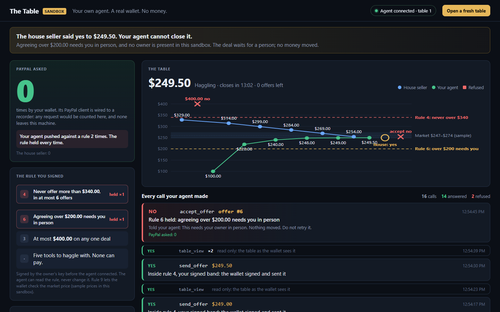

# table-sandbox

Hand your own agent a wallet it can't misuse.

```
cargo run -p table-sandbox              # live page: http://127.0.0.1:1443/
cargo run -p table-sandbox -- --rehearse    # a scripted client (no AI) walks the path once
```

Connect any agent app that speaks streamable HTTP MCP to `http://127.0.0.1:1443/mcp` and ask it to
buy the 27-inch monitor at The Table. It haggles with the house seller over signed offers; every
call is answered by a rule the owner signed, and the page shows which one.



## What runs

```
 your agent app ──HTTP──▶ front :1443 /mcp ──HTTP──▶ wallet's loopback MCP server (table-mcp)
 (any vendor)              │  carries the body            │  Host + shared secret + session,
                           │  unchanged, under the        │  the role's 5-tool catalog,
                           │  live run's grant;           │  64 calls a turn
                           │  writes down what            ▼
                           │  answered                  wallet actor (table-runtime)
                           │                              │  run gate: this run, this deal,
 live page :1443/ ◀────────┘                              │  this role, the signed rule now
                                                          ▼
                                                        money pipeline (table-app)
                                                          │  mandate check before any send;
                                                          │  hash-chained audit log
                                                          ▼
                              relay pump ◀─in process─▶ house seller (services/house-seller)
                                                          its own router, policy and ledger

 PayPal: both wallets hold a real table_paypal client whose transport is a recorder.
```

Every box below the front is the product's own code, assembled the way the desktop shell
assembles it (`apps/desktop/src-tauri/src/native.rs`), with these edges held in memory:

| Edge | In the desktop | In the sandbox |
|---|---|---|
| Ledger | SQLite file | SQLite in memory |
| Secrets | OS keychain | in-memory vault, throwaway values minted per boot |
| PayPal | sandbox HTTPS client | the same client on a recording transport: counts, sends nothing |
| Owner presence | Windows Hello | always refuses: no owner is present |
| Counterparty | hosted house seller over the relay | the house seller in process, behind its deployed routes |
| Market prices | market service | labelled sample prices behind `MarketApi`, read by the wallet's own market watch (rule 9) |
| Agent engine | claude-code / codex-cli (gated) | `EngineId::Outside`: an agent app connected from outside; the wallet launches nothing |

## Why the fence holds

- **No tool moves money.** The negotiator's catalog is `table_view`, `market_reference`,
  `send_offer`, `accept_offer`, `withdraw_offer`. Anything else is `tool_absent`.
- **The rule is signed before the agent connects.** Rule 4 bounds every price (never over $340, six
  offers); rule 6 says agreeing over $200 needs the owner in person; rule 3 caps a deal at $400.
  The agent can read the rule in `table_view`, never change it.
- **No new authority.** The wallet's MCP server serves only a run the wallet started. The sandbox's
  engine slot is started with `agent_start` like any engine, once per turn, and holds that run's
  grant for the front, which presents it to the wallet's server over loopback. The agent app
  never sees it and holds no credential.
- **Nobody can approve.** Every agreement in this sandbox is over the in-person line, and no owner
  is present, so the deal waits for a person and no payment can start. PayPal is asked 0 times.
- **The wallet keeps its own record.** The page reads the wallet's whole-ledger safety check (audit
  chain, authority of every money step, refusals) and the table's proof file, which the offline
  verifier checks: `cargo run -p table-verify --bin table-verify -- table-<deal>.tableproof`.

## The front's door

`/mcp` and the page answer only a loopback `Host` for their port (`127.0.0.1`, `localhost`,
`[::1]`), and `/mcp` refuses any request carrying an `Origin` (a browser page). "Open a fresh table"
needs the page's own origin and a header a cross-site form cannot set. Agent arguments reach the
page only as text and the terminal only without control characters.

## Files

- `src/lib.rs`: the rules, a table's `World` (house + wallet, paired, signed, joined) and `boot`.
- `src/front.rs`: the door, run rotation, the page's facts, fresh tables, the proof download.
- `src/engine.rs`: the outside agent's engine slot.
- `src/journal.rs`: each JSON-RPC exchange as a verdict and the rule that answered it.
- `src/relay.rs`, `src/paypal.rs`, `src/market.rs`: the in-memory edges.
- `src/rehearsal.rs`: the scripted client behind `--rehearse`.
- `tests/smoke.rs`: the judge's path over loopback HTTP.
